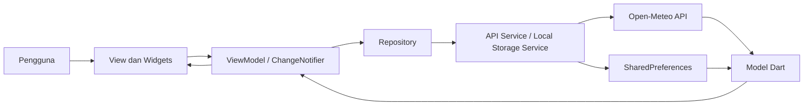
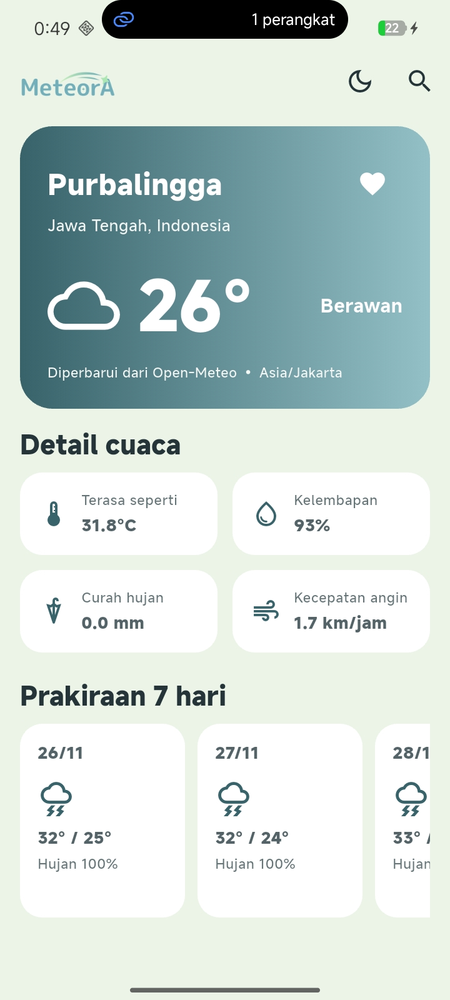
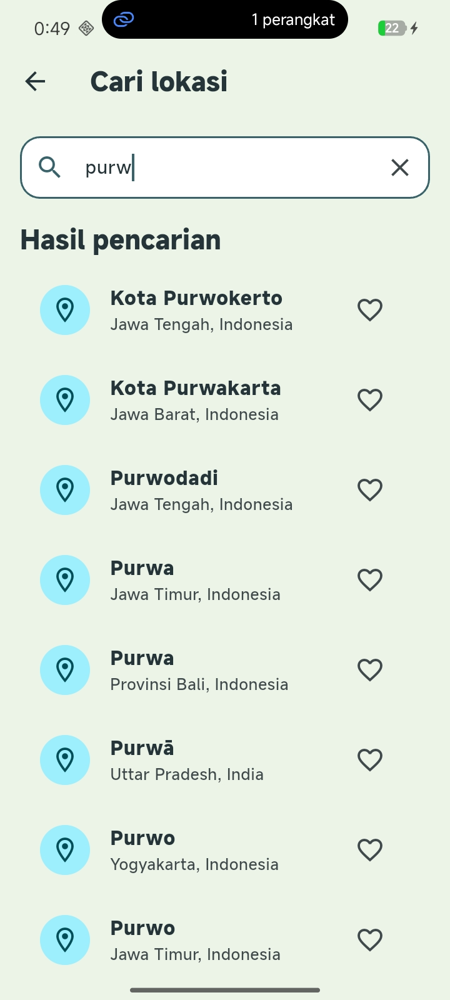
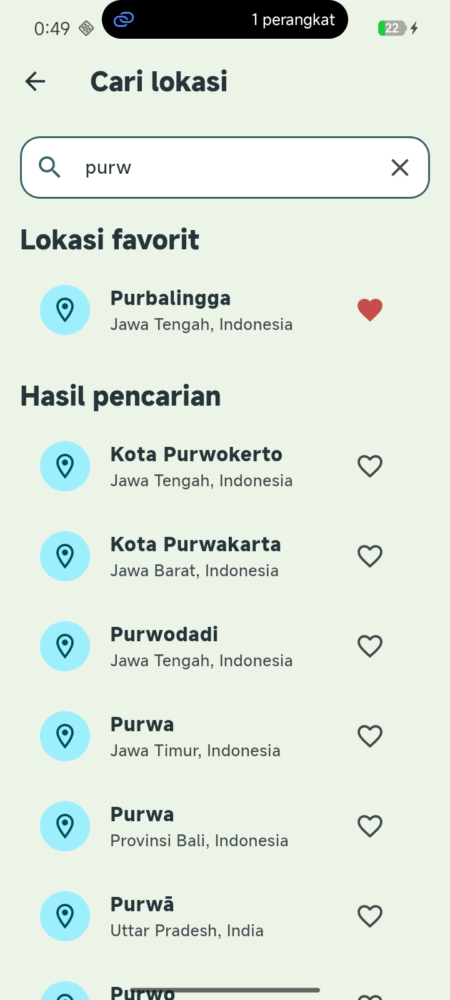
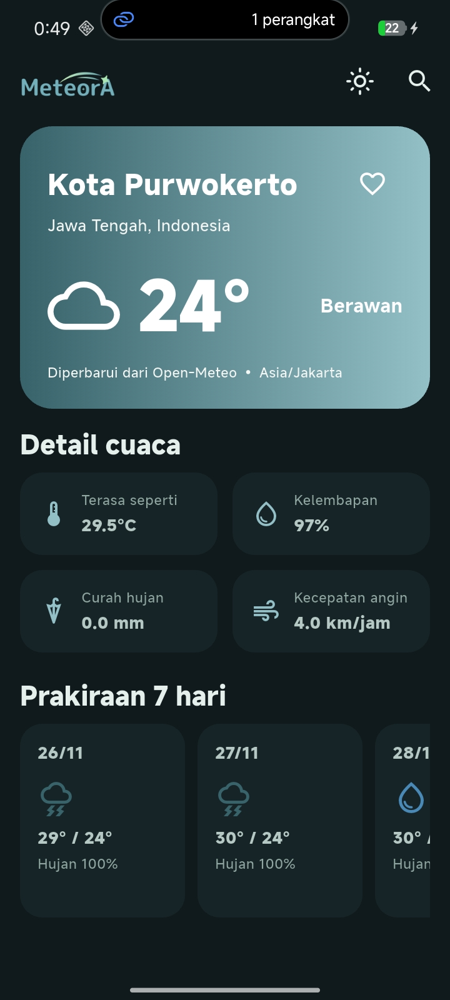
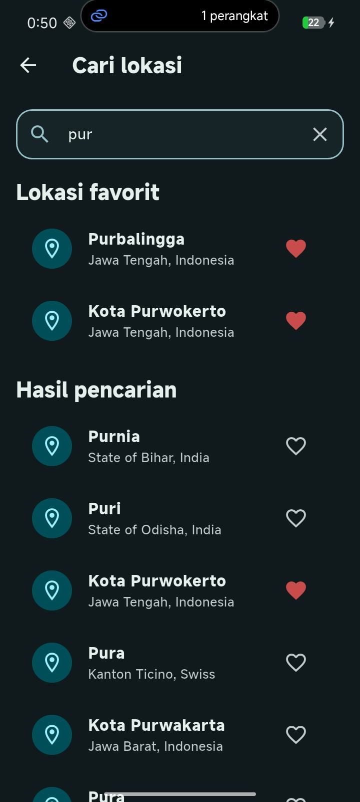

<p align="center">
  
</p>

<h1 align="center">Meteora<br><small>(Aplikasi Informasi Cuaca)</small></h1>

| Identitas | Keterangan |
|---|---|
| Nama | Sani Aprillia Anjani |
| NIM | H1D024011 |
| Shift Awal | H |
| Shift Akhir | F |

## Deskripsi

Meteora merupakan aplikasi informasi cuaca berbasis Flutter yang menggunakan Open-Meteo API untuk menampilkan kondisi cuaca terkini dan prakiraan cuaca berdasarkan lokasi yang dipilih pengguna.

## Fitur Aplikasi

- Informasi cuaca terkini berdasarkan lokasi pilihan pengguna.
- Pencarian lokasi berdasarkan nama kota melalui Geocoding API.
- Informasi suhu saat ini dan suhu yang dirasakan.
- Kelembapan udara, curah hujan, kecepatan angin, dan kondisi cuaca.
- Prakiraan cuaca selama 7 hari.
- Suhu minimum dan maksimum harian.
- Peluang hujan harian.
- Penyimpanan lokasi favorit.
- Penyimpanan lokasi terakhir dan pemulihan lokasi saat aplikasi dibuka kembali.
- Light Mode dan Dark Mode yang dapat mengikuti pengaturan perangkat atau diubah melalui tombol tema.
- Loading state, empty state, error handling, retry, dan refresh data.

## Teknologi yang Digunakan

| Teknologi/Package | Fungsi |
|---|---|
| Flutter dan Dart | Framework dan bahasa pemrograman aplikasi. |
| Material Design 3 | Sistem komponen dan tampilan antarmuka. |
| MVVM | Pola arsitektur untuk memisahkan UI, state, dan logika aplikasi. |
| `provider` | State management menggunakan `ChangeNotifier` dan `Consumer`. |
| `http` | Mengirim HTTP GET ke Open-Meteo API. |
| `shared_preferences` | Menyimpan lokasi favorit, lokasi terakhir, dan pilihan tema secara lokal. |
| `cupertino_icons` | Dukungan ikon bergaya Cupertino. |
| `intl` | Dependency utilitas internasionalisasi dan pemformatan. |
| `flutter_launcher_icons` | Menghasilkan launcher icon Android dari aset Meteora. |
| `flutter_lints` | Aturan linting untuk menjaga kualitas kode Dart. |

## Arsitektur MVVM

Meteora menerapkan arsitektur MVVM dengan Repository dan Service sebagai lapisan pendukung.

- **Model**: Merepresentasikan data lokasi, cuaca saat ini, dan prakiraan harian. Model melakukan parsing respons JSON ke objek Dart.
- **View**: Menampilkan UI melalui `WeatherScreen`, `SearchScreen`, dan widget reusable seperti kartu cuaca, kartu detail, kartu prakiraan, dan pesan state.
- **ViewModel**: Mengelola state pencarian, lokasi, favorit, loading, error, refresh, dan data cuaca menggunakan `ChangeNotifier`.
- **Repository**: Menjadi penghubung antara ViewModel dengan service, yaitu `LocationRepository` dan `WeatherRepository`.
- **Service**: Menangani komunikasi HTTP dengan Open-Meteo dan penyimpanan lokal menggunakan `LocalStorageService`.



Alur utama aplikasi adalah View menerima aksi pengguna, ViewModel mengubah state dan meminta data melalui Repository, Repository meneruskan proses ke Service, lalu respons diparse menjadi Model dan ditampilkan kembali oleh View melalui Provider.

## Struktur Folder `lib/`

```text
lib/
├── main.dart
├── core/
│   ├── app_colors.dart
│   ├── app_theme.dart
│   ├── theme_view_model.dart
│   ├── view_state.dart
│   └── weather_code_mapper.dart
├── models/
│   ├── current_weather_model.dart
│   ├── daily_forecast_model.dart
│   ├── location_model.dart
│   └── weather_model.dart
├── repositories/
│   ├── location_repository.dart
│   ├── repositories.dart
│   └── weather_repository.dart
├── services/
│   ├── geocoding_api_service.dart
│   ├── local_storage_service.dart
│   └── weather_api_service.dart
├── viewmodels/
│   ├── location_viewmodel.dart
│   └── weather_viewmodel.dart
├── views/
│   ├── search_screen.dart
│   └── weather_screen.dart
└── widgets/
    ├── forecast_card.dart
    ├── location_tile.dart
    ├── state_message.dart
    ├── weather_detail_card.dart
    └── weather_summary.dart
```

- `core/`: Tema, warna aplikasi, state umum, pemetaan kode cuaca, dan pengelola tema.
- `models/`: Struktur data dan parsing JSON.
- `repositories/`: Abstraksi akses data dari service.
- `services/`: Komunikasi API dan penyimpanan lokal.
- `viewmodels/`: State dan logika presentasi aplikasi.
- `views/`: Halaman utama cuaca dan pencarian lokasi.
- `widgets/`: Komponen antarmuka yang dapat digunakan kembali.

## Implementasi REST API

Aplikasi menggunakan HTTP GET melalui package `http`. URL dibangun menggunakan `Uri.https`, respons diperiksa berdasarkan status code, kemudian JSON diparse menjadi model Dart. Request memiliki timeout 12 detik dan error ditangani oleh ViewModel agar UI dapat menampilkan pesan dan tombol retry.

### Geocoding API

Endpoint:

```text
https://geocoding-api.open-meteo.com/v1/search
```

Parameter yang digunakan:

- 
ame`: nama kota yang dimasukkan pengguna.
- `count=10`: jumlah maksimum hasil pencarian.
- `language=id`: bahasa hasil pencarian Indonesia.
- `format=json`: format respons JSON.

Hasil pencarian diparse menjadi `LocationModel` yang berisi informasi seperti nama lokasi, negara, wilayah, ID, latitude, dan longitude.

### Weather Forecast API

Endpoint:

```text
https://api.open-meteo.com/v1/forecast
```

Parameter yang digunakan:

- `latitude` dan `longitude`: koordinat lokasi terpilih.
- `current=temperature_2m,relative_humidity_2m,apparent_temperature,precipitation,weather_code,wind_speed_10m`.
- `daily=temperature_2m_max,temperature_2m_min,precipitation_probability_max,weather_code`.
- `timezone=auto`: menggunakan zona waktu otomatis sesuai lokasi.
- `forecast_days=7`: mengambil prakiraan 7 hari.
- `temperature_unit=celsius`.
- `wind_speed_unit=kmh`.
- `precipitation_unit=mm`.

Data cuaca diperoleh langsung dari API dan bukan dari data hardcoded. Respons `current` diparse menjadi `CurrentWeatherModel`, sedangkan respons `daily` diparse menjadi daftar `DailyForecastModel` di dalam `WeatherModel`.

Dokumentasi resmi:

- [Open-Meteo Weather Forecast API](https://open-meteo.com/en/docs)
- [Open-Meteo Geocoding API](https://open-meteo.com/en/docs/geocoding-api)

## State Management dan Local Storage

Provider digunakan untuk menyediakan ViewModel ke widget melalui `ChangeNotifierProvider`. Perubahan data diberitahukan dengan 
otifyListeners`, kemudian bagian UI yang menggunakan `Consumer` dibangun ulang.

`SharedPreferences` digunakan oleh `LocalStorageService` untuk menyimpan:

- `favorite_locations`: daftar lokasi favorit dalam bentuk JSON.
- `last_selected_location`: lokasi terakhir yang dipilih.
- `theme_mode`: pilihan tema manual light atau dark. Jika belum ada pilihan manual, aplikasi menggunakan `ThemeMode.system` untuk mengikuti pengaturan perangkat.

## UI/UX dan Desain Aplikasi

Aplikasi menggunakan Flutter Widgets dan Material Design 3. `ThemeData`, `ColorScheme`, `TextTheme`, dan typography digunakan untuk menjaga konsistensi tampilan. Layout menggunakan widget responsif seperti `LayoutBuilder`, `Wrap`, `Expanded`, dan `ListView` agar dapat digunakan pada ukuran layar yang berbeda.

Tema terang dan gelap tersedia melalui `theme` dan `darkTheme` pada `MaterialApp`. Secara default, `ThemeMode.system` mengikuti pengaturan perangkat. Tombol tema di sebelah kiri tombol pencarian dapat digunakan untuk memilih mode secara manual.

Aplikasi juga menggunakan custom launcher icon dari `assets/images/meteora_logo.png` dan brand wordmark `assets/images/meteora_wordmark.png` pada header halaman cuaca.

### Palet Warna Utama

| Color Role | Hex Code |
|---|---|
| Primary | `#93BFC7` |
| Secondary | `#ABE7B2` |
| Tertiary | `#CBF3BB` |
| Background | `#ECF4E8` |
| Primary Dark | `#38636B` |
| Text Primary | `#243438` |
| Surface | `#FFFFFF` |

Tema gelap menggunakan background `#101A1C`, surface `#172427`, teks terang `#E5F0ED`, dan warna sekunder yang disesuaikan agar tetap terbaca pada kontras gelap.

## Screenshot Aplikasi

### Light Mode

| Weather Screen | Search Screen | Favorite Location |
|---|---|---|
| <br>Cuaca terkini dan prakiraan 7 hari. | <br>Pencarian lokasi berdasarkan nama kota. | <br>Daftar lokasi favorit pengguna. |

### Dark Mode

| Weather Screen | Search dan Favorite Location |
|---|---|
| <br>Tampilan cuaca dalam tema gelap. | <br>Pencarian dan lokasi favorit dalam tema gelap. |

## Cara Menjalankan Aplikasi

1. Clone repository:

   ```bash
   git clone https://github.com/saniaprl/H1D024011-Responsi-Flutter.git
   ```

2. Masuk ke folder project:

   ```bash
   cd H1D024011-Responsi-Flutter
   ```

3. Pasang dependency:

   ```bash
   flutter pub get
   ```

4. Hubungkan perangkat Android atau jalankan emulator.
5. Jalankan aplikasi:

   ```bash
   flutter run
   ```

## Pengujian

Perintah pengujian yang digunakan dalam project:

```bash
flutter analyze
flutter test
```

Hasil pengujian terakhir yang dapat dicantumkan pada dokumentasi ini: **belum diverifikasi pada sesi finalisasi README**. Jumlah test yang berhasil: **belum tersedia**. Jalankan kedua perintah tersebut pada environment Flutter yang digunakan sebelum mengisi hasil final pada bagian ini.

## Video Penjelasan Aplikasi

**Link Video:** https://youtu.be/-c3Q0XNOwes

